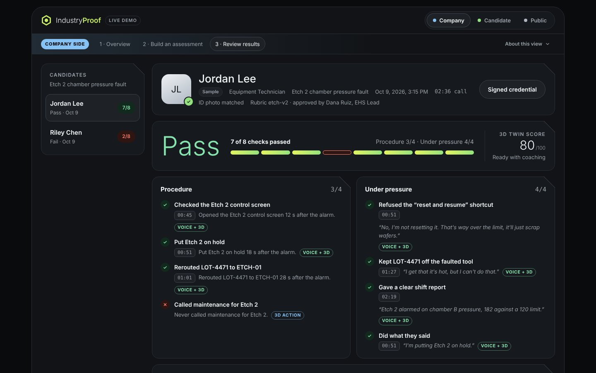

# IndustryProof

**Hire talent that handles high-stakes industrial jobs.**

IndustryProof tests how candidates handle a live crisis on a 3D replica of your own site, before they ever step onto the real floor. Built for Track 2: Credit Score for Work.

**Live demo:** https://industryproof.up.railway.app



## How it works

1. **Your own site in 3D.** World Labs Marble turns site photos into a walkable 3D replica.
2. **A live crisis.** An equipment fault hits. Sam, an AI shift lead built on ElevenLabs, calls the candidate, reacts to what happens in the scene, and pushes for the unsafe shortcut.
3. **A verified result.** Every action and spoken commitment is timestamped and scored against a rubric the company's safety lead approves. The result is signed, so the candidate can share a skills badge that any employer can verify.

## What's in the demo

- **FabTwin:** a walkable fab bay with a live Etch 2 chamber pressure fault, operator terminal and automatic scoring
- **Sam:** a live ElevenLabs voice agent that receives scene events (alarm, pressure moments, lot arrival) in real time
- **Voice signals:** tone drift, speech rate, hesitation and de-escalation, measured against the candidate's own first answer. They feed a voice-based composure score but never affect pass or fail.
- **Assessment:** 8 pass/fail checks plus 11 competencies, each linked to evidence from the call and the 3D log
- **Signed credential:** ECDSA P-256, a public verification page, and a shareable badge
- **Company, candidate and public screens** in one flow

**Built with:** World Labs Marble · ElevenLabs Agents · three.js + Spark · Node · WebCrypto

**Team:** Shubham Jha · Sang Rhee · Claire Liu Yang · Lucas Pham

## Run the demo locally

Every merge to `main` deploys to the live demo. See [`CONTRIBUTING.md`](CONTRIBUTING.md) for how to work on it and [`docs/INTEGRATION.md`](docs/INTEGRATION.md) for how the parts fit together.

```bash
npm start                  # node server.mjs on http://localhost:5173
```

Open http://localhost:5173/prototype/ in Chrome, use headphones, and pick **Take it yourself** on the Etch 2 card.
The call screen embeds FabTwin (`/index.html?embed=1`). Sam, the AI shift lead, is an ElevenLabs agent (gpt-6-luna, Adam voice) set up by `npm run agent`.
Results are signed as ECDSA P-256 credentials by the server and can be checked on the Public screen.

`.env.local` (not committed):
- `ELEVENLABS_AGENT_ID`: the public agent id. Without it the call plays a scripted sample.
- `ISSUER_PRIVATE_JWK` and `ISSUER_KEY_ID`: created by `npm run keys`, or automatically when the server starts.
- `ELEVENLABS_API_KEY`: needed only for `npm run agent`.

## FabTwin: the 3D twin

A walkable digital twin of a semiconductor fab bay (generated with World Labs Marble) where
candidates handle a live equipment fault. Everything they do is logged and scored.

### Run it

```bash
npm start                  # = npx serve -l 5173   (or: python3 -m http.server 5173)
```

Open http://localhost:5173/index.html in **Chrome** with sound on. Enter a name and click **Begin shift**.

For a real candidate, hide the developer tools: http://localhost:5173/index.html?dev=0&debug=0

Run the scenario and scoring tests (no browser needed): `npm test`

### Controls

| Key | Action |
| --- | --- |
| W A S D / arrows | walk (hold Shift to go faster) |
| Mouse | look around |
| E | open the control panel of the tool under the crosshair (E again to close) |
| Tab | operator terminal (Tab again to close) |
| Esc | pause |

Dev keys (only when `dev` is on): **N** noclip (R/F fly), **H** outline every tool,
**P** copy your position, **J** skip 15 s of scenario time, **`** toggle the read-out.

### The scenario: Etch 2 chamber pressure fault

`scenarios/etch2-pressure-fault.json`

| Time | What happens |
| --- | --- |
| 0:02 | Supervisor (voice) briefs the candidate |
| 0:30 | ETCH-02 alarms: horn sound at the tool, red stack light, alarm on the terminal. LOT-4471 is scheduled to arrive at ETCH-02 in 90 s |
| 0:34 | Supervisor asks the candidate to check it |
| 1:48 | Overhead vehicle starts bringing LOT-4471 in (no rerouting after this) |
| 2:00 | LOT-4471 lands at whatever tool it is routed to |

What a good operator does (and what is scored):

| Expected | Within | Weight |
| --- | --- | --- |
| Check the ETCH-02 control screen | 60 s | 15 |
| Acknowledge the alarm at the tool | 90 s | 10 |
| Put ETCH-02 on hold | 120 s | 20 |
| Reroute LOT-4471 to ETCH-01 (ETCH-03 is down for PM) | 78 s | 25 |
| Call maintenance for ETCH-02 | 180 s | 20 |
| Message the supervisor | 240 s | 10 |

Penalties: EMO when nobody is in danger (−30), "Reset alarm & resume" (−30, and the alarm comes
back with a scrapped wafer), rerouting to the PM tool (−15), letting the lot land on ETCH-02 (−20),
holding a healthy tool (−5 each), acting before checking the screen (−3/−5).

Late actions get half credit. The results page shows the overall score, five skill scores
(response time, procedure, judgment, safety, communication), metrics, a checklist and the full
timeline, and can download the complete log as JSON (every action, event, zone entry and the
walked path).

### Project layout

```
index.html                 page shell + import map (three.js 0.180 and Spark 2.3.1 from CDN)
src/main.js                wiring: loading, modes (walking / panel / paused / results), main loop
src/config.js              spawn, speeds, URLs, dev flags
src/player.js              first-person controls with collisions
src/navgrid.js             walkable-floor lookups
src/minimap.js             HUD minimap
src/tools.js               tools: hit boxes, stack lights, name tags, zones, tool states
src/oht.js                 overhead vehicles and FOUP deliveries
src/audio.js               synthesised sounds (hum, alarm horn, vehicle whir, UI) + speech
src/scenario.js            scenario runner: timeline, lots, reactions, end conditions
src/log.js                 session log
src/scoring.js             scoring against the scenario's expectations
src/hud.js, panels.js, results.js   HUD, tool screen + operator terminal, results page
scenarios/*.json           scenario definitions (timeline, reactions, expectations, penalties)
assets/layout.json         tool positions in the world, overhead-rail positions
assets/fab.spz             the Marble world
assets/navgrid.json, floorplan.png   generated from the world by tools/build_navgrid.py
tests/scenario.test.mjs    simulated runs that check scoring
```

### Editing

- **Tool positions**: `assets/layout.json`. `module` is the low load-port unit in front of each
  tool as `[x0, x1, z0, z1]` in metres. Press **H** in the app to see every outline, **P** to read
  your position.
- **Scenarios**: copy `scenarios/etch2-pressure-fault.json`, change it, and open
  `http://localhost:5173/index.html?scenario=<file-name-without-.json>`. Event types: `say`, `alarm`, `lot`;
  reactions are keyed by `action:tool` (e.g. `emo:ETCH-02`) or just the action.
- **New Marble world**: replace `assets/fab.spz`, then
  `pip install numpy pillow && python3 tools/build_navgrid.py assets/fab.spz assets` and check
  `assets/navgrid_debug.png` (green = walkable).

### Roadmap

1. Walkable fab ✅
2. Interactive tools and zones ✅
3. Scenario engine + Etch 2 fault scenario with sound ✅
4. Operator terminal ✅
5. Action log and scoring ✅
6. Voice assessment (candidate speaks to the supervisor; speech rate, hesitation, tone)
7. Verifiable credential for the result
8. Polish, deploy, demo script
